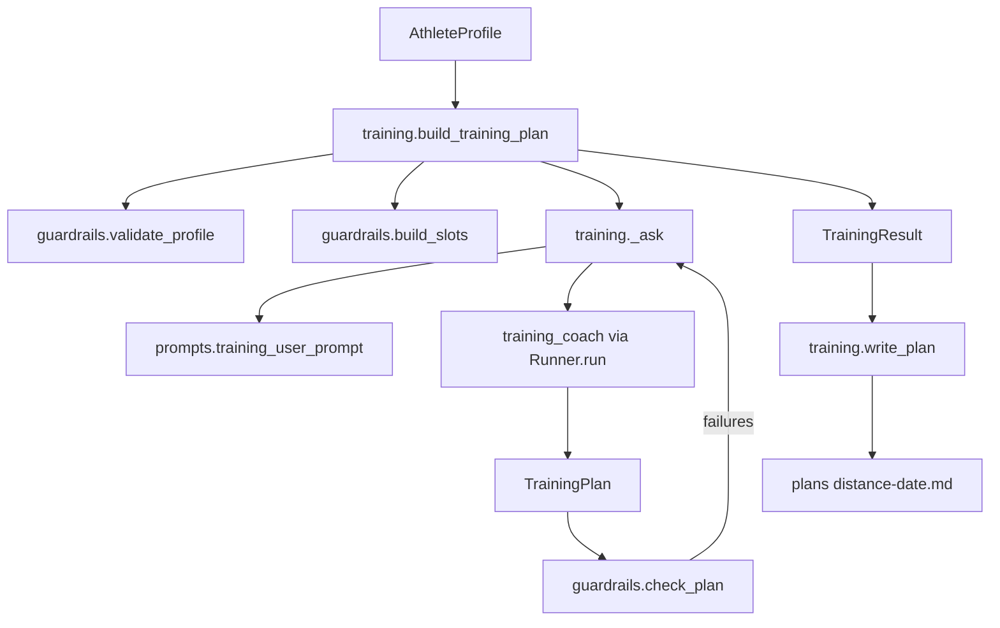

# Initial plan generation

This document covers one path: Garmin history is reduced to an `AthleteProfile`, Python checks that profile, a model fills the calendar, and the result is written as markdown. Plan generation starts at `build_training_plan` in [`src/whoneedsacoach/planner/training.py`](../src/whoneedsacoach/planner/training.py). The profile is assembled before that call.

The chat loop and Monday revision are separate and are not described here. [`src/whoneedsacoach/planner/build.py`](../src/whoneedsacoach/planner/build.py) also contains a deterministic plan builder. `build_training_plan` does not call it. The same file does supply the week totals used to turn Garmin runs into `weekly_km`.

## What you get

`build_training_plan` returns a `TrainingResult` in memory: a `TrainingPlan` plus a list of warnings. `write_plan` is what saves it. The file is

```text
plans/{race_distance}-{race_date}.md
```

For a half marathon on 29 January 2027 that is `plans/half-2027-01-29.md`. Rest-only weeks are left out. Each training day is one line. Tempo and interval days print their structure. Other days print distance and pace. The summary adds the starting weekly kilometres and the peak week.

This path does not open SQLite. The database is described at the end for when some other path has created `data/coach.db`.

## Input

`AthleteProfile` in [`src/whoneedsacoach/models/training.py`](../src/whoneedsacoach/models/training.py) is the only input:

| Field | Meaning |
| --- | --- |
| `race_distance` | `5k`, `10k`, `half`, or `marathon` |
| `race_date` | Race day |
| `weekly_km` | Current weekly distance. `0` means not running now |
| `pb_distance`, `pb_time`, `pb_date` | Optional personal best. Time is `MM:SS` or `H:MM:SS`. All three fields come together, or none of them |
| `run_days` | Weekdays the athlete will run |
| `long_run_day` | One of `run_days` |

Python owns the calendar. The model writes a workout only for the dates it is given. A day it omits is a rest day. The model never sees the Garmin run list. `athlete_profile` keeps weekly kilometres and an optional best, and drops the individual runs.

## Garmin

Reads go through `Garmin` in [`src/whoneedsacoach/tools/garmin.py`](../src/whoneedsacoach/tools/garmin.py). `garmin_session` starts the Garmin MCP server (`uv run garmin-mcp` in `GARMIN_REPO`) and limits it to `get_activities_by_date` and `get_personal_record`. A token directory, when passed, is set as `GARMINTOKENS`. Each tool call is appended to the coach log.

`runs_between` pages `get_activities_by_date` for `activity_type` `running`, 100 activities at a time, and keeps activities whose type is `running` or missing. Each kept run is `id`, `date` (the first 10 characters of `start_time`), and `distance_km` (`distance_meters / 1000`, rounded to three decimals).

`personal_record` calls `get_personal_record` with no arguments. A response that is not a JSON array becomes no record. Otherwise it looks up the race distance:

| Race distance | Garmin `record_type` |
| --- | --- |
| `5k` | Fastest 5K |
| `10k` | Fastest 10K |
| `half_marathon` | Fastest Half Marathon |
| `marathon` | Fastest Marathon |

A match with `raw_value` set returns `time_seconds` and `date`. Anything else returns no record.

The window is the last four complete Monday–Sunday weeks. `four_complete_weeks` takes the Monday of the current week and steps back four weeks, so the week that contains today is left out. Both callers pass that Monday through the Sunday of the newest of those four weeks.

`complete_week_totals` sums `distance_km` in each of those weeks and records the longest run in the week. A week with no runs is 0.

Two callers turn that into an `AthleteProfile`.

`generate` in [`src/whoneedsacoach/agent/executor.py`](../src/whoneedsacoach/agent/executor.py) opens a session with no token directory and fetches runs only. `median_weekly_km` is the median of the four weekly totals, rounded to one decimal. If every week is 0, the median is 0. That number replaces `weekly_km` on the fixed `PROFILE` in [`planner/training.py`](../src/whoneedsacoach/planner/training.py). Race, run days, long-run day, and personal best stay on `PROFILE`: a half marathon on 29 January 2027, Wednesday / Friday / Sunday with the long run on Sunday, and a 10k best of `49:04` on 1 June 2026. `generate` does not call `personal_record`.

`finish` in [`src/whoneedsacoach/agent/flow.py`](../src/whoneedsacoach/agent/flow.py) fetches runs and `personal_record` for the race already stored on the plan. `snapshot_from_runs` builds:

| Snapshot field | Source |
| --- | --- |
| `weeks` | The four weekly totals |
| `baseline_weekly_km` | Median of those totals when any week is above 0, otherwise absent |
| `baseline_long_run_km` | Longest single run across those weeks when any week is above 0, otherwise absent |
| `pr` | `time_seconds`, `date`, and `pace_sec_per_km` (`time_seconds` divided by the race distance in kilometres) when Garmin returned a record |
| `need_baseline` | True when every week is 0 |
| `need_pr` | True when `pr` is absent |

If Garmin has no runs and a previous snapshot already has `baseline_weekly_km`, that saved baseline is kept and `need_baseline` is cleared. A saved `pr` is kept the same way when Garmin has no record. A declined best stays declined. `finish` stops before building a profile while a baseline is still missing, or while a best is missing and has not been declined.

`athlete_profile` then copies race distance and date from the saved race (mapping `half_marathon` to `half`), `weekly_km` from `baseline_weekly_km`, and run days from the saved schedule. `baseline_long_run_km` is not a profile field. When `pr` is present, the best distance is the race distance, the time is `pr["time_seconds"]` formatted as `MM:SS` or `H:MM:SS`, and `pb_date` is set when the record has a date. A best with a time and no date leaves `pb_date` empty, which `validate_profile` rejects because a best needs all three fields.

`validate_profile` rejects a profile before any model call when:

- the race is fewer than 56 days after today
- weekly distance is outside 0–120 km
- run days repeat, or there are fewer than 2 or more than 6
- a run day is not `mon` through `sun`
- the long run is not one of the run days
- a personal best is incomplete, dated in the future, not `MM:SS` or `H:MM:SS`, or outside a plausible time range for that distance

`build_training_plan` calls `validate_profile` directly, so a bad profile raises `ValueError`. `check_profile` is the wrapper that turns the same error into `{"error": ...}` for a caller that wants a payload instead of an exception.

Runner mode, from `runner_mode`:

- **new** — `weekly_km` is 0 and there is no personal best
- **returning** — `weekly_km` is 0 and there is an old best
- **amateur** — `weekly_km` is above 0

A new runner gets walk/run and easy running only, with those words as both paces, and never tempo or intervals. With no personal best, paces stay the cues `walk/run` or `easy`. The model is not asked to invent a min/km pace. A best older than about six months (183 days) still allows tempo and intervals, at the slower fences. A half or marathon from 0 km/week aims to finish, including by run/walk, and does not support a time goal. That case is a standing warning: it is recorded, and it does not by itself ask for a revision.

Other rules the prompt and the checks share: easy running is the default; at most one tempo or intervals day in a week; those weeks alternate, starting with tempo; quality work stays out of a short opening week, the first four full weeks, and the taper. Long-run caps, how large a share of the week the long run may be, and taper length differ by distance. The prompt states the same numbers the checks enforce. The checks still run after the model returns.

## File flow



Call order inside `build_training_plan`:

1. `validate_profile` in [`planner/guardrails.py`](../src/whoneedsacoach/planner/guardrails.py).
2. `build_slots` walks from today through race day and tags each date `rest`, `run`, `long`, or `race`. Race day wins when it falls on a usual run day.
3. `standing_warnings` adds the zero-volume half or marathon warning when it applies. That list does not trigger a revision.
4. `_ask` builds the user prompt and runs the coach. See the next section.
5. `check_plan` returns one message per unmet check. An empty list means the draft passed.
6. If anything failed, `_ask` runs once more. The second prompt includes the failure messages and the previous plan, and asks the model to fix the failures and keep the days that passed.
7. The revision is checked again. If it still fails, those messages are appended to `warnings` and the revision is kept. A second miss is a warning, not an exception. If the revision passes, the warnings list stays at the standing warnings only.

`today` defaults to `date.today()` when the caller omits it.

`write_plan` builds the slots again, renders them with `plan_markdown`, and writes the file under `plans/` (or a directory the caller passes). `plan_document` is a separate helper that groups the same workouts into Monday weeks for a caller that wants JSON. `write_plan` does not use that dict.

## The coach call

`_ask` lives in [`planner/training.py`](../src/whoneedsacoach/planner/training.py). It builds a prompt with `training_user_prompt` in [`prompts/training.py`](../src/whoneedsacoach/prompts/training.py) and runs the agent with `Runner.run`.

The agent is `training_coach` in [`agent/training_coach.py`](../src/whoneedsacoach/agent/training_coach.py):

- name `Training Coach`
- instructions `COACH_INSTRUCTIONS`
- `output_type` `TrainingPlan`, so the runner returns a parsed plan as `final_output`
- `max_tokens` 16384
- the shared `model` from [`models/llm.py`](../src/whoneedsacoach/models/llm.py)

`create_model` uses xAI (`https://api.x.ai/v1`, model `GROK_MODEL` or `grok-4.7`) when `XAI_API_KEY` is set. Otherwise it uses the local Ollama server (`OLLAMA_BASE_URL`, default `http://localhost:11434/v1`, model `OLLAMA_MODEL`, default `gemma4:latest`). Tracing is disabled.

The user prompt lists mode, today, race, weekly distance, run days, long run, the personal best or its absence, pace fences when a best exists, the training rules, and the days to fill. Rest days are in the slot list and are checked later. They are not listed for the model. On the revision call, the prompt also includes the failed checks and the previous plan.

## What the model returns

`TrainingPlan` has `short_summary` and `workouts`. Each `Workout` is one training day. Rest days are omitted.

| Field | Meaning |
| --- | --- |
| `date` | The training day |
| `kind` | `easy`, `long`, `tempo`, `intervals`, or `race` (`rest` exists on the type and is omitted in practice) |
| `distance_km` | Distance for that day |
| `pace_low` | Faster end, as min/km `M:SS`, or an effort cue |
| `pace_high` | Slower end. Same value as `pace_low` when there is one pace |
| `structure` | One line for tempo or intervals: total distance, warmup, work, rest, cooldown. Empty on easy, long, and race days |

`DaySlot` is the skeleton Python builds: `date`, `weekday`, and `role` (`rest`, `run`, `long`, or `race`). The coach does not invent slots.

`plan_document` groups workouts by Monday into weeks shaped as `week_start` plus `sessions` (date, weekday, type, distance, paces, structure), with `plan_start`, `short_summary`, and `warnings` on the document. That shape is for a JSON caller. The markdown file is the artifact `write_plan` produces.

A missing workout on a day that should have been filled renders as `missing` in the markdown. A rest day, or a workout the model marked `rest`, is skipped.

## Checks

`check_plan` walks the slots, then adds week-level checks. Failures are strings. They are sent back once. They are not raised.

Per day, via `_check_day`:

- A workout on a rest day is rejected. A missing rest day is the plan.
- A run, long, or race slot needs exactly one workout, and no workout may fall outside the calendar.
- Kind must match the role: a run day is `easy`, `tempo`, or `intervals`; a long day is `long`; race day is `race`. Distance must be present and non-negative.
- A new runner cannot have tempo or intervals. Quality work is rejected in the early weeks and the taper. Intervals require a personal best.
- Tempo and intervals need a structure line that names the warmup and the cooldown. Every other kind must leave `structure` empty.
- With no personal best, both paces must be `walk/run` or `easy`. With a best, paces are min/km and `pace_low` is the faster end. Easy and long must be slower than the half-marathon fence. Tempo and intervals may sit on their fence and may not go faster. Race pace is not fenced.

Across the plan:

- `_check_quality_count`: at most one tempo or intervals day in a Monday–Sunday week.
- `_check_quality_alternation`: quality weeks go tempo, then intervals, then tempo. Skipped for a new runner and when there is no personal-best date.
- `_check_volume` builds weeks and then checks the build (`_check_build`), long-run growth and share (`_check_long_runs`, `_check_target_long_runs`), and the taper (`_check_taper`).

The numbers live in [`planner/guardrails.py`](../src/whoneedsacoach/planner/guardrails.py). The prompt repeats them so the model sees the same fences the checker uses.

## Database

`write_plan` and `build_training_plan` do not create or update a database. If `data/coach.db` is missing, nothing in this path has connected.

Other code can open SQLite through [`store/db.py`](../src/whoneedsacoach/store/db.py). The default path is `data/coach.db`. `COACH_DB` overrides it ([`utils/config.py`](../src/whoneedsacoach/utils/config.py)). Connecting creates the file and the tables if they are absent.

```bash
sqlite3 data/coach.db
.tables
.schema
.mode line
SELECT id, name, garmin_token_dir FROM users;
SELECT id, user_id, status, race_json, schedule_json, snapshot_json, plan_json, pending_json FROM plans;
```

`.quit` leaves the shell. On SQLite 3.38 or newer, one JSON column can be printed with `SELECT json_pretty(plan_json) FROM plans;`.

There is one plan row per user. `race_json`, `schedule_json`, `snapshot_json`, `plan_json`, and `pending_json` are JSON text, not separate tables.

## Tests

[`tests/test_training.py`](../tests/test_training.py) covers `athlete_profile`, grouping workouts into weeks, and markdown rendering. It does not call Garmin or the model. [`tests/test_planner.py`](../tests/test_planner.py) covers `median_weekly_km` and `snapshot_from_runs`, including a week of zeros and the open week being left out of the median. [`tests/test_repo.py`](../tests/test_repo.py) covers the database, which this path does not write.
