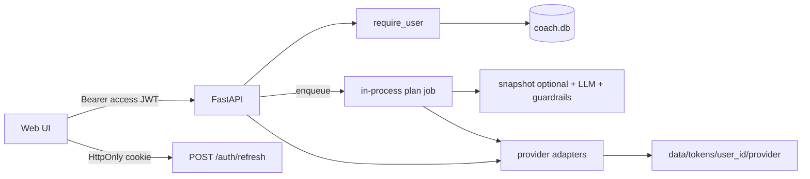
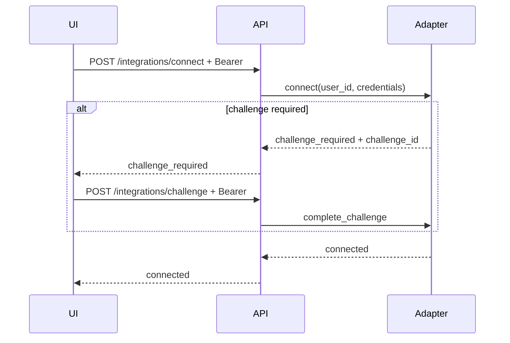

# Software design

Backend and app-facing software for WhoNeedsACoach: FastAPI auth, provider integrations, async plan create/read, SQLite via `Repo`. Coaching rules, Garmin history reduction into an athlete profile, and the LLM + guardrails path live in [`docs/design.md`](design.md). The HTTP request/response contract is [`docs/api.md`](api.md).

This slice is one process. No separate queue worker, no Postgres, no frontend.

## Architecture



**Stack:** FastAPI + Uvicorn, SQLite through [`Repo`](../src/whoneedsacoach/store/repo.py), bcrypt passwords, PyJWT access tokens. Plan jobs run as FastAPI `BackgroundTasks` / asyncio on that process.

Entry point: `whoneedsacoach.api.app:app` via `create_app` in [`api/app.py`](../src/whoneedsacoach/api/app.py). App state holds `repo`, `tokens_root`, and the provider `registry`. CORS allows configured origins with credentials.

## Data model

Never store provider or app passwords in plaintext. Refresh plaintext is never stored (SHA-256 hash only).

```text
Relationships
-------------
users 1 --- * refresh_tokens
users 1 --- * provider_connections
users 1 --- 0..1 plans
users 1 --- * activities
plans 1 --- * activities

users
  id                  PK
  email               UNIQUE
  password_hash
  display_name
  created_at

refresh_tokens
  id                  PK
  user_id             FK -> users
  token_hash          UNIQUE
  created_at
  revoked_at

provider_connections
  id                  PK
  user_id             FK -> users
  provider            UNIQUE with user_id
  token_dir
  status
  connected_at

plans
  id                  PK
  user_id             FK -> users, UNIQUE
  status
  race_json
  schedule_json
  snapshot_json
  plan_json
  error_message
  failed_at
  updated_at

activities
  id                  PK
  user_id             FK -> users
  plan_id             FK -> plans
  session_date
  garmin_activity_id
  distance_km
  duration_seconds
  workout_id
```

Schema and migrations: [`store/db.py`](../src/whoneedsacoach/store/db.py). Default file `data/coach.db` (`COACH_DB`). Connecting creates the file, enables WAL and foreign keys, and migrates older CLI-shaped `users` rows (name identity → email, `garmin_token_dir` → `provider_connections`).

**`users`:** email is identity (lowercased UNIQUE). `display_name` is optional. CLI-only rows may have `password_hash` null until someone registers through the API.

**`refresh_tokens`:** opaque cookie → `sha256` in DB. No `expires_at`, no rotation. Valid until logout (`revoked_at`) or row deleted. Multiple concurrent sessions are multiple rows. Logout revokes the matching hash only.

**`provider_connections`:** unique `(user_id, provider)`. v1 `provider` is `garmin`. `token_dir` under `TOKEN_ROOT / user_id / provider`. `status`: `connected` | `disconnected`.

**`plans`:** one row per user. HTTP statuses: `pending` → `building` → `active` | `failed`. JSON columns hold race, schedule, snapshot, and the finished plan document. `pending_json` remains on the table for CLI review flows; the HTTP path does not use it. `error_message` / `failed_at` are set on failure.

**`activities`:** completed scheduled workouts. `garmin_activity_id` is unique per user; the column name is Garmin-shaped even if later providers reuse the table.

## Auth token contract

| Token | Type | Lifetime | Transport | Used on |
| --- | --- | --- | --- | --- |
| Access | Signed JWT HS256 (`sub` = `user_id`, `exp`, `jti`) | ~15 min (`AUTH_ACCESS_TTL_SECONDS`) | JSON `access_token`; send as `Authorization: Bearer` | All protected routes |
| Refresh | Opaque 32+ bytes | Until logout (no TTL) | `Set-Cookie` only: `HttpOnly`, `Secure` when `AUTH_COOKIE_SECURE`, `SameSite=Lax`, `Path=/auth` | `POST /auth/refresh`, `POST /auth/logout` |

Implementation: [`auth/tokens.py`](../src/whoneedsacoach/auth/tokens.py), [`auth/passwords.py`](../src/whoneedsacoach/auth/passwords.py), routes in [`api/auth_routes.py`](../src/whoneedsacoach/api/auth_routes.py).

- Secret: `AUTH_JWT_SECRET`. Persist `sha256(refresh)` only.
- Refresh does not rotate and does not expire by time.
- Logout: clear cookie + revoke hash. Access JWTs may remain valid until `exp` (accepted for v1).
- `require_user` in [`api/deps.py`](../src/whoneedsacoach/api/deps.py) guards integrations, plan, and `/me`.
- Provider connect and plan create are independent: both need login only. A user may create a plan with zero connections.

Routes: `POST /auth/register`, `/auth/login`, `/auth/refresh`, `/auth/logout`. Endpoint shapes are in [`docs/api.md`](api.md).

## Integrations API

Provider-agnostic surface. Provider names appear as a `provider` field or path segment value, not as separate public route families per vendor.



| Method | Path | Behavior |
| --- | --- | --- |
| `POST` | `/integrations/connect` | `{provider, email, password}` → `connected` or `challenge_required` |
| `POST` | `/integrations/challenge` | `{provider, challenge_id, code}` |
| `GET` | `/integrations` | list connections |
| `DELETE` | `/integrations/{provider}` | disconnect; delete token files best-effort |

v1 adapter is Garmin via [`LoginService`](../src/whoneedsacoach/auth/login.py) wrapped by [`integrations/garmin.py`](../src/whoneedsacoach/integrations/garmin.py). Credentials are request-only. Challenge state is in-process (~5 minutes), bound to `user_id` + `provider`. Registry: [`integrations/registry.py`](../src/whoneedsacoach/integrations/registry.py). Protocol: [`integrations/base.py`](../src/whoneedsacoach/integrations/base.py).

Connecting does not create a plan. Creating a plan does not require a connection.

## Async plan API

| Method | Path | Behavior |
| --- | --- | --- |
| `GET` | `/me` | Profile, integrations summary, current plan `status` or null |
| `GET` | `/plan` | Whole plan resource, or `404` if none |
| `POST` | `/plan` | Create or overwrite; enqueue build; return quickly with `pending` |

No week sub-route. No accept/reject. No piecemeal intake PUTs. Always overwrite — never `409` for an existing plan.

### Statuses

| Status | Meaning |
| --- | --- |
| `pending` | Accepted; job not started or queued |
| `building` | Optional provider snapshot + LLM + guardrails + optional week push |
| `active` | Done; `plan_json` populated |
| `failed` | Terminal; `error_message` (+ `failed_at`) set |

```text
POST /plan → pending → building → active
                          ↘ failed
active|failed → pending (on overwrite POST /plan)
```

Job logic: [`jobs/plan_build.py`](../src/whoneedsacoach/jobs/plan_build.py).

1. Validate auth + body sync (`validate_plan_request`). Bad input → `4xx` before enqueue.
2. Upsert the user’s plan row: store race/schedule/snapshot, clear prior plan/error, set `status = pending`, stamp a `generation_id` on the snapshot.
3. Enqueue background work; respond `202` with `status: pending`.
4. Worker sets `building`, optionally enriches from Garmin (client baseline/PR still win when provided), runs `build_training_plan`, optionally `schedule_current_week`, then `active` or `failed`.
5. Client polls `GET /plan` until `active` or `failed`.

A second `POST /plan` while building overwrites inputs and marks `pending` again. Stale jobs compare `generation_id` and exit without writing `active`/`failed` for a superseded generation.

Coaching internals (profile validation, slots, LLM revision loop, markdown write) stay in [`docs/design.md`](design.md).

## Module layout

```text
src/whoneedsacoach/
  api/
    app.py
    deps.py
    auth_routes.py
    integration_routes.py
    plan_routes.py
    schemas.py
  auth/
    login.py          # Garmin LoginService (CLI + adapter)
    passwords.py
    tokens.py
  integrations/
    base.py
    garmin.py
    registry.py
  jobs/
    plan_build.py     # pending → building → active|failed
  store/
    db.py
    repo.py
```

CLI agent flow (`agent/flow.py`, `cli.py`) and planner/tools modules are the coaching side; they share `Repo`, `LoginService`, and Garmin tools with the API.

## Config

From [`utils/config.py`](../src/whoneedsacoach/utils/config.py):

| Env | Role |
| --- | --- |
| `AUTH_JWT_SECRET` | HS256 secret (must set in production) |
| `AUTH_ACCESS_TTL_SECONDS` | Access JWT lifetime (default 900) |
| `AUTH_COOKIE_SECURE` | `Secure` on refresh cookie |
| `CORS_ORIGINS` | Comma-separated UI origins (credentials enabled) |
| `COACH_DB` | SQLite path |
| `COACH_TOKENS` | Token root (`TOKEN_ROOT`) |
| Provider / LLM | `GARMIN_*`, `XAI_API_KEY` / Ollama vars as used by tools and the coach |

No refresh TTL env. CORS: UI origin + `credentials: true`.

## Security (v1)

- HTTPS in production; turn `AUTH_COOKIE_SECURE` on.
- Generic `401 Invalid credentials` on app login.
- Provider passwords never logged or stored.
- Token dirs `0700` / files `0600` under `TOKEN_ROOT / user_id / provider`.
- Challenge IDs bound to `user_id` + `provider`.
- Parked for v2: refresh TTL, rotation, reuse detection, access denylist after logout, multi-instance challenge/job coordination.

## Explicit non-goals (this slice)

- Refresh lifetime / rotation / stolen-token handling
- Week sub-resource; accept/reject; piecemeal intake over HTTP
- Requiring a provider to create a plan; `409` on existing plan
- Postgres; separate worker fleet
- Strava / Apple / Coros adapters; chat streaming
- Frontend

## Tests and HTTP contract

API behavior: [`tests/test_api_auth.py`](../tests/test_api_auth.py), [`tests/test_api_integrations.py`](../tests/test_api_integrations.py), [`tests/test_api_plan.py`](../tests/test_api_plan.py) (fakes; no live Garmin or LLM). Repo/schema: [`tests/test_repo.py`](../tests/test_repo.py).

For method/path bodies and response shapes, use [`docs/api.md`](api.md).
